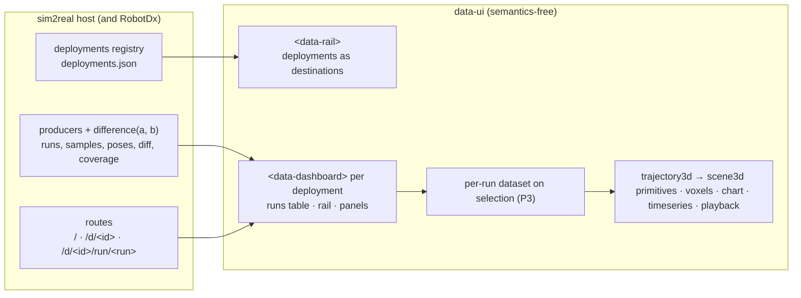

# PEP 0010: robotics playback, stock dashboards per part type, and the diagnostics view hints

- **Status:** proposed 2026-10-28 on `lane/robotics-plan`. Docs only, from main 56e08be; not merged.
  - Nothing here is built.
  - Implementation starts after the current merge packet (`lane/dashboard-cards`, `lane/legend-toggle`, `lane/live`)
    is on main.
  - The CONTRACT amendment takes the next free § when it lands. When this was written that was §31 (§30 is Mermaid;
    §25, §26 and §28 were held for dashboard-cards, live and types). §31 went to interactive legends, so P1a's
    amendment is §32 (§15 below).
- **Asked by:** Zach, 2026-10-28 (zach_brain `Sources/Daily Notes/Daily Note - Oct 28 2026.md`, "Sim to real feedback"
  and "What is next?"; the evening's trajectory-panel notes were relayed by the dispatching session):
  - "we are expecting trajectories in a certain format and then we can easily like display them"
  - "Data UI doesn't need to know the robotic semantic meaning behind these things."
  - "we should make a really great robotic data visualizer first and THEN afterwards I can integrate the diagnostics
    layer"
  - "each type of robot part can have its own stock dashboard where at a glance I can see everything I need to see"
  - "the library feature just allows you to like draw frames draw arrows etc. And now this is a very particular viewer
    for a very particular dataclass."
  - "Data-UI should have standard views for showing diagnostics data. Also for showing gates, and KPIs etc. RobotDx
    should be using those stock parts and now so can sim 2 real."
- **Builds on:**
  - **data-ui:** PEP 0004 (dashboards, §17), PEP 0005 (the cards and the one clock), PEP 0008 (one clock driver),
    `lane/live`'s PEP 0008 (live data and rewind; the number is taken twice, see §14).
  - **traj_compare's 3D panel as it landed:** bam_ws `src/core/mdp/agent/actor/trajectory_generation/traj_compare/`.
    - The reference implementation is `report.py`, `assets/viewer3d.js` and `assets/viewhelper.js`.
    - The live example is `~/bam_ws/reports/media/rack-sensors-2026-10-21/report.html`.
    - Zach's words are in `traj_integration_tests/docs/Logs.md`, lines 364-640, 1072-1140 and 1605-1625.
  - **The tracking-run contract** (vault: *Tracking-Run Data — data-ui vs Rerun (2026-10-26)*).
  - **BAM Reach's reach map** (`bam_reach/src/bam_reach/reach_map.py`, `colorize.py`).
  - **sim2real's five proposals** (`~/sim2real/dashboards/`).
  - **RobotDx's data-ui rebuild** (io-diagnostics `lane/robotdx-data-ui` @ 17f7747, its PEP 0001).
  - **The sim2real gaps** (`reports/backlog-sim2real-gaps-2026-10-28.md`).
- **Mocks:** `docs/peps/0010-robotics-playback/*.png`, one per stock dashboard plus the deployment page.
  - They are proposals: no data-ui code draws them.
  - `make_mocks.py` beside them rebuilds them, with matplotlib through uv.
  - Their numbers come from:
    - 1,000 rack runs with ≥ 20 samples, with CAN 12's twin replay;
    - the rack's gates;
    - RealSense frame stamps;
    - BAM Reach's reach map;
    - sim2real's UR5e stand-in, labelled.
  - The gripper, depth and hyperspectral panels are labelled illustrative or empty.

## 1. The answer

1. **Playback first, diagnostics as an overlay.**
   - A robotic data visualiser ships first.
   - Diagnostics and gates come later, as a second `.base` over the same datasets that adds gate datasets and overlay
     views.
   - data-ui never computes a gate or a metric. RobotDx's Python library does (§10).
2. **Two layers, as Zach named them.**
   - **Layer 1 is a library of 3D primitives:** points, lines, frames, arrows, arcs, meshes, boxes and voxels. They are
     drawn from any columns. The vocabulary is Rerun's archetypes (`Points3D`, `LineStrips3D`, `Arrows3D`,
     `TransformAxes3D`, `Asset3D`, `Boxes3D`, `VoxelGridMap`), and `type: scene3d` exposes it as a generic view.
   - **Layer 2 is the trajectory viewer** (`type: trajectory3d`): "a very particular viewer for a very particular
     dataclass".
   - The viewer is a thin binding from the trajectory contract (§4) onto Layer 1, plus its own controls:
     - per-trajectory display mode (line, points, frames);
     - compare two trajectories;
     - decay;
     - the view cube and projections;
     - robots per trajectory.
3. **The robotics knowledge lives in the data and in five templates, never in data-ui.**
   - Layer 1 and the statistics views know no robotics words.
   - Layer 2 knows exactly one shape: a timed pose per series, with its reference and its link poses. It never knows
     which part made the data, or which family is real; the `.base` maps families to colours.
   - A producer writes the contract (§4) and gets its part type's stock dashboard. Each template is a gallery `.base`
     under Examples → Use case: Robotics.
   - The contract is rows and column names. If Zach moves the types into an `lk_msgs` package, its dataclasses emit
     these rows and no view changes (§13 Q7).
4. **Two engines, split by job.**
   - **three.js for space:** both layers, and the `voxels` heatmap with its slices.
   - **Vega-Lite for statistics:** histograms, box plots, and 2D bins of non-spatial pairs, in the existing `chart`
     type.
   - No third engine. deck.gl and an embedded Rerun lost (§3).
5. **Colour has two levels.**
   - The family gives the hue: real is blue (`--data-series-1`), sim is orange (`--data-series-2`), and the target is
     muted and dashed.
   - Members of a family get line styles, not new hues.
   - Green and red are status only, always with a glyph (§7).
6. **Navigation is split by owner.**
   - data-ui provides the parts: the rail, the dashboard, the runs table, and a per-run dataset loaded on selection.
   - sim2real provides deployments → runs → run, and the producers (§8).

## 2. The frame, challenged

- **"A stock dashboard per part type" is right, but the dashboards compose.**
  - An arm's joint panels are the Servo panels, filtered by the device rail. Zach's two screenshots ("Servo: J3 elbow" /
    "J4 wrist 1") are exactly that.
  - So there are five templates, not five apps. Arm and Arm + Gripper repeat the Servo and Driver panels' YAML. No
    include mechanism is proposed.
- **Show/hide is the rail's job.**
  - Zach, Oct 28 evening: the top-level filters already cover it.
  - The rail's `situation` facet hides a trajectory in every panel at once. No per-trajectory eye is added. The legend
    toggle (lane/legend-toggle) stays the per-panel shortcut it is on every chart.
- **"Compare two trajectories" is a function, and its output is data.**
  - `difference(a, b)` takes two trajectories and returns a difference trajectory. It is computed once, in Python, in
    the trajectory library (today traj_compare's `tp`/`tquat`; tomorrow `lk_msgs` or RobotDx).
  - The viewer draws it as arrows and Z-arcs, and the plots draw its error column. data-ui never interpolates one
    trajectory against another.
  - WHY: the tracking-run contract says derived channels are computed once in Python and no viewer recomputes them.
    One definition cannot drift.
- **"1/n opacity" stops working past about 255 runs.**
  - The rack alone has 1,001 runs (90 + 330 + 581 over Oct 23-25) and 720,765 samples at a median 94.4 Hz.
  - At 1/1001, an 8-bit framebuffer stores 0.25/255, which rounds to 0, so every path vanishes.
  - Paths take exactly 1/n, no floor (Zach's brief; amended at the P2 merge, 2026-10-29): measured, it holds to about
    200 runs and loses the path past that. An exact "how many runs passed here" comes from `voxels` with `value: runs`, which
    counts instead of blending. Zach already guessed the 2D views would help most.
- **Decay is in seconds, not time steps.**
  - Real samples at about 94 Hz, while a twin or a Menagerie replay runs at 25-100 Hz. A 50-step trail is 0.5 s of one
    and 2 s of the other.
  - So the setting reads "Decay 0.5 s (≈ 47 samples at 94 Hz)".
- **BAM Reach has no voxels and no slices.**
  - It built a grid of positions (0.025 m default step), each scored by the fraction of reachable orientations. It is
    drawn as a Viser point cloud on a 7-bin red → yellow → green ramp (`colorize.py:8-46`).
  - Slicing exists only as Zach's notes (`docs/ref/bam_reach/README.md:300-332`), an Open3D prototype in `docs/ref/`,
    and an SVG mock (`reach_ux_babble_gallery.html`).
  - `workflow_report.py`, which the brief named, holds no heatmap.
  - So `voxels` is new. It follows `reach_map.py`'s grid, those notes, and Rerun's `VoxelGridMap`.
- **Blue and orange work, but sim orange sits next to the fail red.**
  - Measured: data-ui's orange (slot 2) against its tracker's fail tone is ΔE 9.3 in normal vision, in both themes.
  - So status always carries a glyph and a word, and the robotics templates push fail toward crimson (§7).
- **The convention is already broken twice, to fix at the next touch:**
  - the sim-to-real case paints `sim_identified_plus` green (`#19a979`, lane/dashboard-cards `views.base`);
  - `arm_suite_sim.py` labels its sim video blue and its "real" video red.
- **"Filters on the right":** the screenshot and every data-ui dashboard put the rail on the left. Kept left; Q4.
- **"Robot Arm 2-7+ DOF":** nothing may assume six joints. The device rail lists whatever devices the data has, and the
  robot poses any named links.

## 3. Criteria, then the one real fork

**Weighted criteria** (the weights sum to 100):

| # | Criterion | Weight | Why this weight |
|---|---|---|---|
| C1 | Zach's spec: the 3D path; the 6 planes; a view cube aligned to the trajectory's frame; all steps or decay; display modes; compare; the coverage views; many-way comparison; the colours; the navigation | 20 | the ask |
| C2 | traj_compare's landed decisions carried over (table below) | 15 | Zach asked that the panel build on where traj_compare landed |
| C3 | data-ui stays semantics-free; robotics lives in the data, the templates and the Layer 2 binding | 15 | his words; every other app uses data-ui |
| C4 | Scale: 1,001 runs and 720,765 samples without stalling a filter click; the budgets measured | 12 | the rack is the first deployment |
| C5 | One engine per job; reuse scene3d, the clock, the legend, tracker, kpi and chart | 10 | PEP 0005 §7 and the one-WebGL-context rule |
| C6 | Shippable lanes with measured acceptance (camera matrices, `getBoundingClientRect`, pixel colours) | 10 | `.claude/feedback.md`; dispatch discipline |
| C7 | Both hosts: sim2real (static run datasets) and RobotDx (one robot's live stream, via lane/live) | 10 | Zach, 2026-10-28 |
| C8 | Stock parts first | 8 | standing rule |

**The fork: what draws the trajectory panel's 2D projections?** The 3D card is already three.js (`scene3d`,
lane/dashboard-cards). Four options:

- **A:** the same three.js stage with an orthographic camera and SVG axes.
- **B:** the existing Vega-Lite `trajectory` card with a plane picker.
- **C:** deck.gl (`OrbitView` + `OrthographicView` + `PathLayer`).
- **D:** an embedded Rerun web viewer.

| | C1 | C2 | C3 | C4 | C5 | C6 | C7 | C8 | Score |
|---|---|---|---|---|---|---|---|---|---|
| **A: three.js stage, orthographic mode** | 5 | 5 | 5 | 4 | 5 | 4 | 5 | 4 | **4.7** |
| B: Vega-Lite `trajectory` + plane picker | 3 | 3 | 5 | 2 | 3 | 4 | 4 | 4 | 3.5 |
| C: deck.gl | 4 | 3 | 5 | 5 | 1 | 3 | 3 | 5 | 3.7 |
| D: Rerun web viewer embedded | 4 | 2 | 5 | 5 | 1 | 2 | 3 | 5 | 3.4 |

Scores run from 1 to 5; the total is the weighted mean.

- **A wins.**
  - The view cube swings one camera from 3D to a face and back, which only one renderer drawing both can do.
  - An oblique "arbitrary slice" can't be built by swapping columns.
  - traj_compare's cube is three's own `ViewHelper`.
- **B:** Vega-Lite's canvas does not scale to coverage overlays. It stays frozen for the cases that use it today.
- **C:** a second WebGL engine beside three, when the UR5e GLB, the shared context and the mesh engine are all three.
- **D:** 51.8 MiB of wasm against Cloudflare's 25 MiB file cap (vault note above). It stays the "Open in Rerun"
  backdoor, which PEP 0005 §6 already ships.

**traj_compare's decisions, Zach's newer words first, and where each stands:**

| Decision (Zach) | When | data-ui today | This plan |
|---|---|---|---|
| Show/hide: "the top level filters already cover it" (replaces July's per-trajectory eye) | Oct 28 eve | rail facets; legend click and Alt-click isolate on lane/legend-toggle | reused; no eye |
| Display modes per trajectory: line, points or frames; a frame is full or Z axis only | Oct 28 eve (July: worded multi-select, not check marks) | no | P1b: a worded mode menu per trajectory, written to the view entry |
| Compare two trajectories: time-matched arrows to where each point should have been; the error value in plots ("often clearer than two lines") | Oct 28 eve, Jul 28-29 | no (the producer writes error columns) | P1d: `diff_*.json` from `difference(a, b)`; Layer 1 arrows and arcs; the error in timeseries |
| Z-axis mode: own Z and the reference Z at the same spot, plus the arc of the quaternion difference | Oct 28 eve, Jul 28 | no | P1d: an `arcs` primitive, traj_compare's construction |
| A log density slider for points, arrows and frames, with a reasonable default | Jul 28, Oct 28 eve | no | P1b: `density`, 4-400 on a log dial, default 20 (traj_compare's mapping) |
| A scrubber with play and step under 3D; a cursor line on every plot; videos synced | Jul 29 | yes: the clock, the playback card, video follow | reused |
| Hovering a plot previews that instant in 3D, drawn up to then | Jul 29 | no: the clock has `hover`, but no 3D card reads it | P1b |
| A Reset zoom button | Jul 29 | timeseries `interactive: true` resets; scene3d double-click fits | P1b: a visible Fit button |
| A view cube, off the shelf (the custom one was "cut off", "contrived") | Jul 29 | no | P1b: three's `ViewHelper`; Q1 (the labelled cube) |
| URDFs: one per trajectory, coloured to match it; colour and opacity per URDF, especially with more than one | Jul 29, Oct 28 eve | the meshed UR5e per series; only the ghost is tinted | P1b: `robots.series.<series>: {color, opacity}` (§15) |
| Settings stay as you switch scenarios, best effort | Jul 29 | yes: view settings live in the view entry (URL `v=`, Save view); a filter change never resets them | reused, with a check |

## 4. The trajectory contract (what a producer writes)

**One rule above the others: the dataset is a display projection.**

- SI stays in the producer's own bundle or npz, as the tracking-run contract says.
- The files data-ui reads carry display units, declared per column, because data-ui converts nothing: rails, URL
  filters, hovers and axes all read the stored number.
- Every column name ends in its unit.

**Thin on purpose.** The contract is rows and column names, never a dataclass. A future `lk_msgs.Trajectory` (or
traj_compare's `Situation`, or RobotDx's `samples`) reaches data-ui through its own `to_rows()` that emits these
columns, so the views never change when the types move.

### 4.1 Words

| Word | Means |
|---|---|
| **deployment** | one installed machine, e.g. the 1-DOF rack at home; a host-level registry row |
| **run** | one execution: a stable, unique id (for the rack, the npz path under the day folder) |
| **situation** | one way of playing the run, which is one series on screen: `real`, `real B`, `twin v7`, `model 2`, `target` (PEP 0005 §3) |
| **source** | the situation's family: `real`, `sim` or `target`. It picks the hue. Every model, twin, replay or prediction is `sim` |
| **device** | the part whose channels a row holds: `CAN 12`, `J3 elbow`, `gripper` |
| **body** | the rigid body a pose row tracks: `tool0`, `lever_tip` |
| **frame** | the frame a pose row's coordinates are written in: `base`, `belt` |
| **difference trajectory** | the output of `difference(a, b)`: a's samples, each paired with b at the same timestamp |
| **display rate** | the rate a producer writes for display, by picking rows, never by averaging |

### 4.2 Tables

Every file is JSON or CSV with a `<name>.schema.json` sidecar that declares each column's `unit` (CONTRACT §3). Missing
is `null`, never 0.

| File | One row per | Required columns | Optional |
|---|---|---|---|
| `runs.json` | run | `run`, `deployment`, `started` (ISO datetime with offset), `duration_s`, `kind`, `devices` (list), `situations` (list), `rate_hz`, `display_hz` | `label`, `basis`, `url` (the run page), `note` |
| `samples.json` | t × run × situation × device | `t` (s from the run's start), `run`, `situation`, `source`, `device` + its type's channels (§4.3) | any extra channel with a unit suffix |
| `poses.json` | t × run × situation × body | `t`, `run`, `situation`, `source`, `body`, `frame`, `x_mm`, `y_mm`, `z_mm` | `quat_w`, `quat_x`, `quat_y`, `quat_z` (unitless, wxyz): needed for frames and Z-arcs |
| `diff_poses.json` | t × run × situation × reference × body | `t`, `run`, `situation` (a), `reference` (b), `body`, `frame`, `x_mm`/`y_mm`/`z_mm` (a), `ref_x_mm`/`ref_y_mm`/`ref_z_mm` (b at t), `err_mm` | `quat_*`, `ref_quat_*`, `err_rot_mrad` |
| `diff_samples.json` | t × run × situation × reference × device | `t`, `run`, `situation`, `reference`, `device`, `e_q_mrad` (b − a at t; `e_q_mm` for a prismatic axis) | `e_qd_deg_s`, `e_tau_nm` |
| `links.json` | t × run × situation | `t`, `run`, `situation`, `source`, `<link>_x/_y/_z` (in the scene's unit), `<link>_qw/_qx/_qy/_qz` | scene3d.robot's columns as built (the producer runs FK; the card only poses) |
| `media.json` | clip | PEP 0005 §3 (`src`, `poster`, `t0`, `fps`, `duration`, `basis`) + `run`, `camera`, `kind: rgb \| depth \| band` | `band_nm` |
| `devices.json` | device | `device`, `type` (`servo`, `driver`, `camera`, `gripper`, `arm`, `eef`), `label`, `parent`, `order` | limits as columns (`q_min_deg`, `q_max_deg`, `qd_max_deg_s`, `tau_max_nm`, `i_max_a`), `part` (robotparts id) |
| `events.json` | event | `t`, `run`, `device`, `kind` (`grasp`, `release`, `contact`, `fault`, `mode`), `label` | marks on time series and on the playback track |
| `coverage_*.json` | the deployment's runs, decimated | as `samples` / `poses`, plus `w` (§4.4) | ≤ 150,000 rows each |
| `grid.json` | voxel cell | `x_mm`, `y_mm`, `z_mm` (cell centres), `value`; `cell_mm` and `frame` in the schema | BAM Reach's reach map as rows |
| `workspace.glb` | mesh | glTF, in metres per the glTF spec, in the poses' frame | or a box in the `.base` |
| `frames.json` (P3+) | frame | `frame`, `parent`, `x_mm`, `y_mm`, `z_mm`, `quat_*` | lets the viewer switch its display frame (Foxglove's "Display frame") |

### 4.3 Channels per device type (unit suffix → unit)

| Type | Channels |
|---|---|
| servo | `q_deg`, `qd_deg_s`, `qdd_deg_s2`, `tau_nm` (`q_mm` and `qd_mm_s` for a prismatic axis) |
| driver | `i_q_a`, `i_d_a`, `v_bus_v`, `temp_c`, `power_w`, `mode`, `fault` (text) |
| gripper | `width_mm`, `force_n`, `grip` (text: open, closing, holding) |
| camera | via `media.json`; frame stamps as `frame_dt_ms` rows in `samples` (the device is the camera) |
| eef / body | via `poses.json` |

The rack's npz already holds `t, q, q_target, qd, qd_target, tau, i_q, i_d, voltage, temp_c, power_w, mode, fault`
(checked on `session_01a/runs/s03_can14_staircase.npz`). `qdd` is not logged, so the producer derives it at full rate
and marks it `basis: derived`.

### 4.4 Rules

- **Time:** `t` is seconds from the run's start (the target's start). `runs.started` gives the absolute order.
- **The target is a situation** (`source: target`), never a column. It is one more series: dashed, muted, and the
  robot's ghost.
- **`difference(a, b)` is the one comparison** (Python, in the trajectory library; one definition):
  - For each sample time tᵢ of `a` inside `b`'s span, `b(tᵢ)` interpolates positions and joint channels linearly and
    orientations by slerp (the short way).
  - Outside `b`'s span there is no row; it never extrapolates.
  - The arrow runs from `a(tᵢ)` to `b(tᵢ)`, so it points to where the point should have been.
  - `err_mm = |b(tᵢ) − a(tᵢ)|`, and `err_rot_mrad = 2·acos(|⟨q_a, q_b⟩|)`.
  - It stays on `a`'s own samples, never a shared resampled clock (the tracking-run rule).
  - The producer writes the pairs that matter: each situation against `target`, and each `sim` against `real`. The
    viewer's Compare menu lists the pairs present.
- **Frames are declared, never guessed.**
  - A pose row's coordinates are in its `frame`, so the view cube aligns with that frame by construction.
  - For conveyor picking the producer writes the `belt` frame (x along the belt, y across, z up), and the top view
    reads cross-belt error directly.
  - Rows in two frames are never mixed. The viewer names both and draws neither.
- **The scene's length unit:**
  - `unit: mm` scales glTF meshes (metres, by spec) by 1000.
  - Link poses are written in the scene unit.
- **Display decimation:**
  - At most 100 Hz per run (rack_replays.py's rule), by picking rows.
  - Coverage files pick rows on a uniform time grid (`display_hz`), so a count is time spent (`count / display_hz` s),
    with `w = 1`.
  - Each run's argmin and argmax row of every channel is kept too, with `w = 0`. Histograms sum `w` and stay unbiased,
    while min/max over rows is exact. Zach asked for "the maximum and minimum position and velocity", and a thinned
    series misses them. This is the M4 idea (Jugel et al., VLDB 2014), weighted.
- **The budget, measured** with Vega-Lite 6.5.0 / Vega 6.4.0 in Node, headless, on real rack q/qd rows:

  | Chart | 150k rows | 720k rows |
  |---|---|---|
  | binning | 85 ms | 460 ms |
  | box plot | 83 ms | 319 ms |
  | 2D 80×80 bin | 105 ms | 436 ms |

  - So a coverage file stays ≤ 150k rows. The rack at 20 Hz comes to about 153k.
  - Past that, the upgrade path is Arrow IPC (§12).
- **Validation:**
  - `node bin/data-ui.mjs check <template>.base --data <file>` names every missing column.
  - Each template's `checks.py` checks the sidecar's units against §4.3.

## 5. Views and cards

### 5.1 Layer 1: `scene3d`, the 3D primitives

A library in `packages/views/scene3d/src/primitives/`: pure functions from columns and rows to three.js objects, drawn
on the one shared WebGL context. `type: scene3d` exposes it as the generic view.

```yaml
- type: scene3d
  scene3d:
    unit: mm                     # NEW: the length unit of every column read (default m); glTF scales from metres
    t: t                         # the time column every primitive is windowed by (decay, hover)
    projection: perspective      # NEW: perspective | top | bottom | front | back | left | right | {dir: [x, y, z], up: [x, y, z]}
    show: all                    # NEW: all | trail      (Zach: "Show all time steps" | "Decay")
    decay: 0.5                   # NEW: seconds behind t; inf = from the start; 0 = only the current sample
    fade: true                   # NEW: the trail fades with age, like a contrail
    axes: auto                   # NEW: ticks in `unit` on a face-aligned 2D view | none (§15: off reads as false in YAML 1.1)
    layers:                      # NEW: any number, each from this view's dataset
      - { primitive: lines, x: x_mm, y: y_mm, z: z_mm, by: [run, situation], color: situation }
      - { primitive: points, x: x_mm, y: y_mm, z: z_mm, density: 20 }
      - { primitive: frames, x: x_mm, y: y_mm, z: z_mm, quat: [quat_w, quat_x, quat_y, quat_z], axes: xyz }   # or axes: z
      - { primitive: arrows, data: diff, from: [x_mm, y_mm, z_mm], to: [ref_x_mm, ref_y_mm, ref_z_mm] }   # data: another dataset
      - { primitive: arcs, at: [x_mm, y_mm, z_mm], from: [quat_w, quat_x, quat_y, quat_z], to: [ref_quat_w, ref_quat_x, ref_quat_y, ref_quat_z] }
      - { primitive: meshes, model: media/ur5e_links.glb, links: [base, shoulder_link], by: situation }
      - { primitive: boxes, min: [x0_mm, y0_mm, z0_mm], max: [x1_mm, y1_mm, z1_mm] }
    workspace: { model: media/reach_hull.glb, opacity: 0.12 }   # NEW: or { box: [[x0, y0, z0], [x1, y1, z1]] }
```

**A layer may read another dataset of its dashboard** (`data: <dataset>`; the default is the view's own `from`).

- Inside a `<data-dashboard>`, each layer's rows are filtered exactly as a panel on that dataset would be (PEP 0004
  §5: its rail, other panels' selections, its links). The view receives them as `input.layers[<dataset>]`.
- No rows are joined, so CONTRACT §10's "join, not adopted" holds.
- This relaxes PEP 0004's "the views of one panel read one dataset" to one dataset per layer. A 3D scene composes
  entities from several sources, as Rerun's and Foxglove's 3D views do.
- A plain `<data-views>` has only its own dataset.
- It is part of the P1a barrier.

**The stage both layers share:**

- **The view cube is three.js r186's `ViewHelper`,** drawn through the shared renderer (+0 contexts), with "Fit" and
  "3D" buttons beside it.
  - A face click animates to that face and switches to an orthographic camera.
- **2D** (a face, or `{dir}` for an oblique slice):
  - Drag pans, the wheel zooms about the pointer, a double-click fits, and nothing rotates.
  - SVG axes use scene3d's own `niceStep`, titled e.g. "x (mm) · frame: belt".
  - Scale is equal by construction.
- **3D:** perspective and orbit, as built.
- **Persistence:** every change goes through `host.setView`, so it rides in the URL and in Save view.
- **The trail is Rerun's visible time range:**
  - `all` is [−∞, +∞]; `trail` is [t − decay, t], with no future; `inf` is [−∞, t].
  - Every primitive carries a per-vertex time, so a clock tick moves two shader uniforms and never rebuilds geometry.
  - "Open in Rerun" writes the matching `VisibleTimeRange` (`cursor_relative`).
- **Hover:** primitives draw at `clock.hover ?? clock.t` (traj_compare's preview).
- **Density** is traj_compare's log dial, 4 to 400 markers per path, default 20. It thins points, frames and arrows
  alike (stride = count ÷ density, plus the last sample).
- **Build:** each primitive is one draw call per layer.
  - lines are `LineSegments2`;
  - arrow shafts are `LineSegments` and their heads one `InstancedMesh` of cones;
  - frames are `LineSegments` with RGB vertex colours;
  - arcs are `LineSegments`;
  - meshes are `GLTFLoader` clones;
  - boxes are `EdgesGeometry`.
- **Back-compat:** today's `scene3d` keys (`x, y, z, series, target, t, skeleton, robot`) keep drawing. They are read
  as a Layer 2 binding (§5.2), so the lane/dashboard-cards cases stay green.

### 5.2 Layer 2: `trajectory3d`, the trajectory viewer

One dataclass, one viewer. It maps the contract (§4) onto Layer 1 and adds the controls Zach named; it has no drawing
code of its own.

```yaml
- type: trajectory3d
  trajectory3d:
    poses: { x: x_mm, y: y_mm, z: z_mm, quat: [quat_w, quat_x, quat_y, quat_z], frame: frame }  # the binding
    series: situation            # one trajectory per value
    family: source               # the colour family (style.families, §7)
    run: run                     # many runs per series → opacity auto
    target: target               # the reference: dashed, muted; the default `b` of Compare
    unit: mm
    modes: { real: [line], twin: [line, frames-z], target: [line] }   # per trajectory: line | points | frames | frames-z
    compare: { data: diff, pairs: [[twin, real]], scale: 1 }   # difference rows (§4.4): arrows; arcs with frames-z; scale 1 | 10 | 30 | 100 is display-only
    density: 20
    show: trail
    decay: 0.5
    projection: perspective
    robots: { data: links, model: media/ur5e_links.glb, links: [...], series: { twin: { color: series, opacity: 0.5 }, target: { opacity: 0.2 } } }   # §15
    opacity: auto                # exactly 1/n over a family's paths, no floor
    workspace: { model: media/reach_hull.glb }
```

- **The per-trajectory menu** (worded, as July asked) holds:
  - display mode: line, points, frames (full), or frames (Z only);
  - the robot's colour and opacity.
  - Show/hide stays on the rail.
- **Compare**
  - It reads a difference dataset (`compare.data`, a layer dataset per §5.1) and draws Layer 1 `arrows` from `a` to `b`
    at the density.
  - It draws `arcs` (own Z, reference Z, and the arc between them) where the trajectory's mode is `frames-z`.
  - `robots.data` is a layer dataset too.
  - The error plots are ordinary timeseries over `err_mm` / `e_q_mrad`.
- **Exaggeration is display-only.**
  - `compare.scale` lengthens the arrows, never the data, and the card says "arrows ×20".
  - This replaces the producer's baked "twin ×20" rows (gap #4) and is traj_compare's Oct 15 "Deviation ×1/10/30/100".
- **A thin binding.**
  - If `lk_msgs` lands, `trajectory3d`'s keys stay. Its `to_rows()` writes these columns, or the binding keys name
    different ones.
- **Reuses:**
  - Layer 1 and its stage;
  - scene3d's robot posing (lerp and slerp at t, exact at rows), the GLB cache and the fitted camera;
  - the clock (t, hover, extent);
  - `seriesColor`;
  - lane/legend-toggle's legend;
  - `host.setView`, for modes, density, compare, decay and projection.

### 5.3 `voxels` (new type, in the scene3d bundle): the discretised space

Its keys mean nothing to paths. The lineage precedent (CONTRACT §21) makes that a type, not a mode. It shares the
stage (camera, cube, projection, unit, workspace) and registers from the same folder, as the chart bundle registers
three types.

```yaml
- type: voxels
  voxels:
    x: x_mm                      # raw rows, binned in the view (≤ 150k rows, §4.4)
    y: y_mm
    z: z_mm
    unit: mm
    cell: 25                     # cell edge in `unit` (BAM Reach's default step, 0.025 m)
    value: time                  # time (Σ w / display_hz) | runs (distinct runs per cell) | count | <property> (pre-gridded rows)
    summary: Average             # for a property: Average | Median | Min | Max | Sum (Bases' names; §15)
    scale: sequential            # sequential (one hue, light → dark) | verdict (good ↔ bad; overlay phase only)
    slice: { axis: z, at: 300 }  # or { axis: z, at: all }: a sum through the depth, i.e. a 2D histogram of the projection
    projection: top
    workspace: { model: media/reach_hull.glb }
    min: 1                       # hide cells below this
```

- **Drawing:**
  - 3D: three `InstancedMesh` boxes at 0.8 × the cell, with the slice plane solid and the rest faded.
  - 2D: the slice is a `DataTexture` (`NearestFilter`) on a plane, which is an image heatmap with crisp cells and axes
    ("look exactly like image heatmaps").
  - A slider steps the slice one cell at a time (BAM Reach README:300, "iterate through").
- **Colour:**
  - One family in the rows: that family's ramp.
  - Mixed families: neutral grey.
  - Never red or green, except with `scale: verdict` in the gates layer, which is where BAM Reach's red → green reach
    score goes.
- **Export:** "Open in Rerun" writes it as `VoxelGridMap`.
- **Reuses:** the stage (camera, view cube, projection, unit, workspace, the one context), the binning edges the rail
  already computes (`bucketsFrom`, `nice`), and `seriesColor`'s family lookup for the ramp.

### 5.4 What needs no new type

| Need | View that exists | Keys the templates use |
|---|---|---|
| 1D histograms of joint p/v/a and EEF x/y/z | `chart` (Vega-Lite) | `bin: {maxbins: 60}`, `y: {aggregate: sum, field: w}`; for comparisons, step lines (`interpolate: step`) by family |
| Box plots with min-max whiskers | `chart` | `mark: {type: boxplot, extent: min-max}`, `x: device`, `color: source` |
| Phase space (q × qd), torque-speed map (i_q × qd) | `chart` | 2D `bin`, `rect`, `color: sum(w)`. Not 3D: the two axes have different units |
| Limits on a histogram or time series | `chart` rule layers from columns; `timeseries.bands` / `rules` | limits as columns (`q_min_deg`). Limits from a property in timeseries and plot is gap #6 (P2) |
| The error value over time | `timeseries` | `y: err_mm` (or `e_q_mrad`) over `diff_*`, `series: situation` |
| Channels over time | `timeseries` (static), `plot` (live, lane/live) | `series: situation`, `dash: [target]`, `legend` |
| The clock | `playback` | `variant: bar` |
| Camera | `video`, `video-compare`, `image` | `video.primary: true` on the real camera |
| Runs, devices, tiles | `table` (`sort: started DESC`, `select: run`), `kpi`, `levels` (lane/live) | as built |

## 6. The stock dashboards (Examples → Use case: Robotics → Playback)

**Each template is one gallery case:**

- one `<data-dashboard>`, with the runs table on top and a run picker on the rail (`as: select`, defaulting to the
  newest run);
- **playback panels** follow the picked run;
- **coverage panels** read an unlinked copy of the deployment's coverage file, so a pick never empties them (the
  sim-to-real case's `can14_*` trick). P3 replaces the copy with a per-run file loaded on selection.

| Template | Datasets | Playback panels | Coverage panels | Mock |
|---|---|---|---|---|
| **Servo** (1 actuator + encoder) | runs, samples, diff_samples, devices, media, coverage_samples | playback; q(t), qd(t), τ(t) for real, sim and target; the error e_q(t); the camera | histograms of q, qd, qdd and τ (real vs sim step lines, limits); a box per device; the q × qd heat | `servo.png` |
| **BLDC driver** | runs, samples, events | i_q(t) beside τ; i_d(t); v_bus(t); temp(t); a mode/fault strip | histograms of i_q and v_bus; the i_q × qd operating map; temp box by run kind | `bldc-driver.png` |
| **Camera** (RGB, RGBD, hyperspectral) | media, samples (frame stamps) | RGB video (primary); depth as a colourised video; a band image picked by a `band_nm` rail slider; the spectrum chart | frame-interval histogram; dropped frames per run | `camera.png` |
| **Robot arm** (2 to 7+ DOF) | runs, samples, poses, diff_*, links, devices, coverage_* | `trajectory3d` in 3D with robots, compare arrows and Z-arcs, plus one 2D projection (top: cross-belt); EEF error over time; q(t) for the rail's joint | `trajectory3d` with every run at `opacity: auto` and the workspace; a `voxels` slice; histograms and boxes per joint and for EEF x/y/z | `arm.png` |
| **Arm + gripper** | the arm's, plus gripper rows and events | the arm's, plus width(t) and force(t) with grasp/release/contact events | the arm's, plus a grip-width histogram and the force at grasp | `arm-gripper.png` |

`deployment.png` is the deployment page: the app rail, the runs table newest first, coverage, and the later gate matrix
as an overlay.

**The Servo template, abridged** (keys marked NEW are from §5 and §7):

```yaml
data: runs.json
style:
  chrome: minimal
  families: { property: source, colors: { real: 1, sim: 2, target: muted } }    # NEW (§7, §15)
clock: { data: samples, time: t }
datasets:
  runs: runs.json
  samples: { data: samples.json, facets: [{ property: run, as: select, label: Run }, { property: device, as: select, label: Servo }, { property: situation, label: Show }] }
  diff: diff_samples.json
  media: media.json
  coverage: coverage_samples.json      # unlinked on purpose: a run pick never empties the coverage panels
links:
  - { from: samples.run, to: runs.run }
  - { from: diff.run, to: samples.run }
  - { from: media.run, to: samples.run }
layout:
  panels:
    - { view: Runs, w: 12, h: 3 }
    - { view: Playback, w: 12 }
    - { view: Angle, w: 8, h: 3 }
    - { view: Camera, w: 4, h: 3 }
    - { view: Angle error, w: 6, h: 3 }
    - { view: Torque, w: 6, h: 3 }
    - { view: Angle coverage, w: 4, h: 3 }
    - { view: Velocity coverage, w: 4, h: 3 }
    - { view: Phase space, w: 4, h: 3 }
views:
  - { type: table, name: Runs, from: runs, sort: [{ property: started, direction: DESC }], select: run }
  - { type: playback, name: Playback }
  - { type: timeseries, name: Angle, from: samples, timeseries: { x: t, y: q_deg, series: situation, dash: [target], legend: top } }
  - { type: timeseries, name: Angle error, from: diff, timeseries: { x: t, y: e_q_mrad, series: situation, legend: top } }
  - type: chart
    name: Angle coverage
    from: coverage
    chart:
      mark: { type: line, interpolate: step }
      encoding:
        x: { field: q_deg, bin: { maxbins: 60 } }
        y: { aggregate: sum, field: w, title: samples at 20 Hz }
        color: { field: source }
  # … Velocity, Torque, Camera (type: video, from: media; "—" when the run has no clip), Velocity coverage and
  # Phase space (2D bin of q_deg × qd_deg_s, color: sum(w)) follow the same pattern.
```

## 7. Colour

**No new tokens.** Families map onto data-ui's validated slots. The robotics hues are data-ui's own blue and orange,
and nothing in data-ui says "real".

| Role | Light | Dark | Rule |
|---|---|---|---|
| Family `real` | `--data-series-1` #2a78d6 | #3987e5 | solid |
| Family `sim` | `--data-series-2` #eb6834 | #d95926 | solid |
| Family `target` | `--data-muted` | `--data-muted` | dashed 5 4; the robot's ghost |
| A family the map doesn't list | `--data-muted` | `--data-muted` | dotted; the legend says "unclassified"; never a hashed `hueOf` slot, which can land on green (3, 6) or red (8) |
| 2nd and 3rd member of a family | same hue | same hue | long dash 8 4, then dash-dot 8 3 2 3, with labels at the path end |
| 4+ members | same hue, `opacity: auto` | same | one legend entry ("real · 37 runs"); a legend or table pick lifts one run to full opacity |
| Robots | their series' colour | | opacity per robot (`robots.series.<series>.opacity`, §15) |
| Compare arrows and arcs | the compared series' colour; the reference Z in muted | | traj_compare's look |
| Density ramps (`voxels`, 2D bins) | the family's ramp, or grey when mixed | | sequential, one hue, light → dark |
| Status (gates layer only) | `--data-good` / `--data-warn` / `--data-bad` | | always a glyph and a word: ✓ pass, ! warn, ✕ fail, – not run, ? unknown, ◷ stale |
| Frame axes (full `frames`, the view cube) | X red, Y green, Z blue | same | RGB = XYZ, the convention in RViz, Rerun, Foxglove and three's `ViewHelper`. It is the one red or green outside status, always labelled, and never a series. `frames-z` draws in the series' colour, as traj_compare does |

**Validator** (dataviz `validate_palette.js`):

- **Slots 1 and 2 pass every check in both themes.**
  - CVD ΔE: 24.7 in light, 26.8 in dark.
  - Normal-vision ΔE: 33.6 in light, 31.8 in dark.
  - Contrast: ≥ 3:1 in both.
- **sim2real's hard-coded `#e8743b` fails the dark lightness band** (L 0.685), so its hosts move to the slots.
- **Sim orange against data-ui's fail tone** measures normal ΔE 9.3 in both themes.
  - A crimson fail (`#c2185b`) reaches 18.1 in light; the best dark crimson found reaches 12.5.
  - So the robotics templates set `--data-bad` to crimson, and the glyph carries status.
- **Shades of one hue fail the normal-vision floor** (ΔE ≈ 11 between steps). That is why members within a family are
  told apart by line style and labels.

**Where it is configured:**

- `style.families: {property, colors: {<value>: <slot | muted | colour>}}` (§15) sits beside `style.palette` and is resolved in
  `seriesColor`.
- A `palette` entry for a series name still wins.
- It is a CONTRACT change in P1a.

## 8. Navigation: what lives where



**The four levels:**

1. **Deployments** (the host's home):
   - a `<data-views>` gallery over `deployments.json`: photo, run count, last run, devices;
   - a roll-up across deployments is a rail facet over the union of their `runs.json`.
2. **One deployment** (one dashboard):
   - the runs table, newest first;
   - the rail (run, device, situation, run kind);
   - coverage over every run the rail leaves;
   - playback of the picked run.
3. **One run:**
   - until P3, a run page (the runs table's `url` column, `open: link`);
   - from P3, the same dashboard loads `runs/<run>.json` when exactly one run is picked;
   - `#t=` / `#tr=` (PEP 0005) make any instant a link, which is also how evidence links work (§10).
4. **Matching performance:** the gate matrix and the KPIs, added by the overlay `.base` (P5).

**Owned by data-ui:**

- `<data-rail>` (§27);
- `<data-dashboard>` with its rail, `select:` and links;
- the per-run dataset template. This is P3 and a CONTRACT barrier: `datasets.<d>: {data: "runs/{run}.json", key: run}`,
  filled when the dashboard's state holds exactly one `run` (the §24 `origin.url` template is the precedent);
- the `#t`, `#tr` and peek URLs.

**Owned by sim2real:**

- the deployments registry and the routes;
- every producer. rack_replays.py and arm_suite_sim.py move onto §4's tables;
- the calls to `difference(a, b)` and the gate computations, through the trajectory library and RobotDx's library;
- the vendored templates.

**RobotDx:** one robot's live stream is a "deployment".

- Its `samples` is a `LiveDataset` (lane/live).
- Its "runs" are sessions or time windows.
- The templates work unchanged once `dx/feed.js` pivots its `key/value` rows into §4.3's device rows. That is a
  host-side adapter. A dataset-level `pivot:` in data-ui is the fallback if a second host needs one.

## 9. Stock parts (Element | Today | Off-the-shelf part | Behaviour that must survive)

| Element | Today | Off-the-shelf part (exact name) | Behaviour that must survive |
|---|---|---|---|
| The primitive vocabulary (Layer 1) | none; traj_compare hand-rolls each | Rerun archetypes `Points3D`, `LineStrips3D`, `Arrows3D`, `TransformAxes3D`, `Asset3D`, `Boxes3D`, `VoxelGridMap`; Foxglove `ArrowPrimitive`, `LinePrimitive`, `ModelPrimitive`, `CubePrimitive` | one primitive = one column binding; "Open in Rerun" maps 1:1 |
| Paths (lines) | scene3d's `Line2` per series (lane/dashboard-cards) | three 0.186.1 `LineSegments2` + `LineMaterial` (`examples/jsm/lines`) | pixel-width lines; dashed target; one draw call per layer |
| Points | none | three `Points` + `PointsMaterial` | log-density thinning (traj_compare) |
| Frames, Z axis only | traj_compare `segmentsObject` (RGB `LineSegments`) | three `LineSegments` with vertex colours | full triad or Z only; same stride as points |
| Arrows (compare) | traj_compare: `LineSegments` shafts + an `InstancedMesh` of cones | three `LineSegments` + `InstancedMesh` + `ConeGeometry` | from a(t) to b(t), time-matched |
| Z-arcs (rotation error) | traj_compare: own Z, ghost Z, normalised-lerp arc | three `LineSegments` | own Z in colour, reference Z muted, arc between them |
| Robots | scene3d.robot (one clone per series; only the ghost tinted) | three `GLTFLoader`, `MeshStandardMaterial` | colour and opacity per robot; posed at t; exact at rows, ≤ 1.34 mm between |
| 2D projections | the Vega-Lite `trajectory` card (2D only) | three `OrthographicCamera` | equal scale; a face is the 3D scene's own projection |
| View cube | none in data-ui; traj_compare vendors three r160 `ViewHelper` | three r186 `ViewHelper` (`examples/jsm/helpers/ViewHelper.js`); alternative: `@mlightcad/three-viewcube` 0.0.10 `ViewCubeGizmo` (MIT; proven in viser-3d-viewer within 0.1°) | click to snap; through the host renderer (+0 contexts) |
| Orbit, pan, zoom | `OrbitControls` | three `OrbitControls` (handles orthographic zoom) | double-click fits; a phone's vertical swipe scrolls |
| Trail / decay | none | Rerun `VisibleTimeRange` (`TimeRangeBoundary.cursor_relative` / `infinite`) as the model; Foxglove 3D's "Decay time" as the word | seconds; no future; fade; a tick changes uniforms only |
| 3D ↔ 2D | none | Foxglove 3D panel's "3D view" toggle (its 2D looks down the fixed frame's z) | one panel, not a second card |
| Display frame | none | Foxglove "Display frame"; three `Object3D` transforms | frames declared, never guessed |
| Voxels and slices | none (BAM Reach: a Viser point cloud) | three `InstancedMesh` + `BoxGeometry`; `DataTexture` (`NearestFilter`) on `PlaneGeometry`; Rerun `VoxelGridMap` as the model | counts equal a numpy `histogramdd` oracle |
| Workspace outline | none | three `EdgesGeometry`, `Box3Helper`, `GLTFLoader` | a translucent fill plus edges; projected for free in 2D |
| Histograms, box plots, 2D bins | chart (Vega-Lite 6.5.0) | Vega-Lite `bin`, `boxplot` (`extent: "min-max"`), `rect` | sum of `w`; exact min and max |
| Time series | timeseries (Vega-Lite; uPlot when interactive), plot (uPlot 1.6.32, lane/live) | unchanged (stock seam) | cursor at t, hover crosshair |
| Clock, scrubber, video sync | `clock.js`, the playback card, `followVideo` | unchanged (stock seam) | one driver; `#t=`; within one frame |
| Legend toggle | lane/legend-toggle (in progress) | unchanged (stock seam); Rerun's legend rule | click hides; Alt or double-click isolates |
| Rail filters (show/hide) | `<data-facets>` | unchanged (stock seam); McMaster / Algolia | `situation` facet hides a trajectory in every panel |
| Open in Rerun | `tools/rerun_export.py` (PEP 0005 §6) | rerun-sdk 0.40.0 (uv extra) | the blueprint gains `VisibleTimeRange`; voxels as `VoxelGridMap` |
| Not adopted | — | deck.gl `OrbitView` / `OrthographicView` / `PathLayer` | a second WebGL engine (§3) |
| Not adopted | — | Rerun web viewer, embedded | 51.8 MiB of wasm against a 25 MiB file cap; stays the backdoor |

## 10. The diagnostics and gates layer: view hints

**Zach sees three workstreams** (2026-10-28):

1. this visualiser;
2. the diagnostics computation. That is RobotDx's Python package: a stock library where a dataclass config
   parametrises each diagnostic and the data comes in at run time, with a registry for custom ones;
3. sim2real showing trajectories with diagnostics on top.

**What data-ui owns here:** the *views* for 2, and the overlay for 3. A diagnostic in the catalog carries a `hint`, one
word from the vocabulary below, which names the stock view that shows it.

| Hint | Shows | data-ui view (exists) | Missing piece (phase) |
|---|---|---|---|
| `gate_matrix` | devices × gates; a cell is pass, warn, fail or not run; a click opens the evidence | `tracker` (`groupBy: device`, `tracker.state`, `tones`; a block click opens the peek on its rows) | P5: column labels (gap #11); `tracker.column: gate`, so cells align by gate and a missing one is an "n/a" cell; a glyph in every block |
| `threshold_band` | a value over time with its warn and error band | `timeseries` / `plot` with `bands` and `rules` | bands and rules from a property, per device or time-varying (gap #6). P2 for limits, P5 for warn and error |
| `kpi_trend` | a KPI with its trend and delta | `kpi` (`compare`, `spark`, `target`, `gate`) | none. RobotDx asks for `select:` on a KPI card |
| `rollup_tree` | component → composite status | `table` + `tree: {parent}`; the §17 dataset roll-up (`Max` of `rank`) for a simple worst-of | P5: a `status` cell display (tone, glyph and word; gap #12 generalised), and RobotDx's mini child-health bars (b1). RobotDx's causal roll-up stays in its host |
| `evidence` | one diagnostic: its value, limits, window and provenance, then the data | the side peek (§13), value sources (§22), the peek trail (§14), `#t=` / `#tr=` links into the run's playback, `<data-analysis>` (§19) for a write-up | P5: a peek section that embeds a view filtered to the peeked row (`record.sections[].view` with `this.` filters, which analyses already bind) |
| `distribution` | a histogram and box plot with limits | `chart` (§5.4) | none: a template |
| `level_history` | a check's level over time | `levels` (lane/live) | none |
| `path_overlay` | error on the path: compare arrows, Z-arcs, colour by error, a tolerance tube | `trajectory3d` compare (P1d); the Vega-Lite `trajectory` card's `color` / `tolerance` in 2D | P5: `color: <property>` and `tolerance` on `trajectory3d` |

**The diagnostic row these views read.** This is the catalog's output; the hints column gives the minimum each needs.

| Column | Meaning | Hints |
|---|---|---|
| `subject` | the device or entity path (`CAN 12`, `arm/J3`) | all |
| `diagnostic`, `title` | the id and the display name | all |
| `level` *or* `verdict` | `level` is RobotDx's and ROS diagnostics' (`ok`, `warn`, `error`, `unknown`, `stale`); `verdict` is the gates' (`pass`, `warn`, `fail`, `not_run`). The `.base`'s `tones:` maps each value to good, warn, bad or muted | gate_matrix, rollup_tree, level_history |
| `rank` | an ordinal for worst-of (RobotDx: ok 0 < warn 1 < unknown 2 < stale 3 < error 4) | rollup_tree |
| `value`, `unit` | the measured number | threshold_band, kpi_trend, distribution, evidence |
| `warn_lo`, `warn_hi`, `error_lo`, `error_hi` | limits as data, as bam_diagnostics' `DiagnosticValue(warn, error)` held them | threshold_band, distribution |
| `target`, `better` | for deltas and gauges | kpi_trend |
| `t`, `t0`, `t1`, `run` | the evaluation time and the evidence window | evidence, level_history |
| `message`, `why` | what happened, and what to check (RobotDx's `why`) | evidence |
| `evidence` | a URL into the playback at the window (`…#t=t0&tr=t0,t1`) | evidence |
| `basis`, `source`, `sourceUrl`, `record` | provenance (§22) | evidence |
| `parent` | the composite this rolls up into | rollup_tree |
| `hint` | one word from the table above | all |

**Both hosts use the same views.**

- sim2real writes `gates.json` and `diagnostics.json` per deployment.
- RobotDx feeds the same columns as a keyed `LiveDataset` (lane/live), and the views draw them as of the clock's t.
- The overlay `.base` is the playback `.base` plus gate datasets and these views. "Playback" and "Playback +
  Diagnostics/Gates" are two gallery cases over the same data, so the seam is a file diff.

## 11. Phases (each a shippable lane)

**Sizes** are in builder-days: S ≈ 0.5-1, M ≈ 2-3, L ≈ 4-5.

**Measuring rule for every check:**

- in the page, through camera matrices, `getBoundingClientRect`, sampled pixel colours and network logs;
- against an oracle computed outside the view (numpy over the case's files);
- in light and dark, at 1280 and 390 px;
- committed before each lane's code, and off-limits to its builder.

**P0: blockers (S-M).** It runs after the merge packet lands (dashboard-cards §25, legend-toggle, live §26).

- **Write set:**
  - `packages/core/src/clock.js` and `packages/dashboard/src/` (gap #1);
  - `packages/core/src/facets.js` and `<data-facets>` (#9, #14);
  - `packages/dashboard/src/index.js` (#13).
- **Checks:**
  - **#1:** the clock spans only the rows the filters leave. Picking a 4.5 s run, the span equals that run's min..max t
    (oracle: the file).
  - **#14:** the default radio is drawn checked (`:checked` and computed style).
  - **#9:** a two-clause dataset filter still lists every run, with counts.
  - **#13:** a `src` set after load reloads the panels.

**P1: the trajectory panel (L, four lanes in this order).**

- **P1a: the contract barrier (S-M). Lands alone, first.**
  - Write set:
    - `docs/CONTRACT.md` §32 (drafted here as §31; §15): `scene3d` layers and stage keys, `trajectory3d`, `voxels` (reserved), `style.families`,
      layer datasets (`input.layers`), and the trajectory contract by reference;
    - the layer-dataset plumbing: `packages/dashboard/src/model.js` filters each layer's dataset as a panel's, and
      `packages/core/src/elements/data-views.js` hands `input.layers` to the view;
    - `schemas/view.schema.json`, `tools/check_views.py`, `packages/core/src/check.js`;
    - `gallery/robotics/CONTRACT.md` (drafted as `gallery/examples/robotics/`; §15) with its `schemas/*.schema.json` (§4), and the `difference(a, b)` spec
      with a fixture (two trajectories in, the expected rows out) that the Python library's tests and the gallery
      checks both read.
  - Checks:
    - both checkers accept the new keys;
    - both refuse `projection: diagonal`, `decay: -1` and `primitive: arow`, each with "did you mean";
    - a layer dataset gets exactly the rows a panel on that dataset would get, under a rail pick, a selection and a
      link (`tests/unit/dashboard.test.mjs` against `panelFilters()`);
    - PEP 0004's existing dashboard checks stay green.
- **P1b: Layer 1 and Layer 2 core (L).**
  - Write set: `packages/views/scene3d/` (`src/primitives/`, the stage, `trajectory3d`), plus the family lookup in
    `seriesColor` (`packages/core/src/clock.js`).
  - Checks:
    - **Projection:** a face click makes the camera orthographic (`proj[15] == 1`) and looking along −Z within 0.1°;
      `v=` holds `projection: top`, and a reload restores it.
    - **Equal scale:** 100 mm on x and on y project within 0.5 px of each other.
    - **Axes:** tick labels sit at their values' projections within 1 px.
    - **Frames:** rows in two frames draw nothing and name both.
    - **Decay:** at t = 3.0 with decay 0.5, the drawn window is [2.5, 3.0] within one sample (the card's hook); `inf`
      starts at t0; a tick rebuilds no geometry and costs ≤ 2 ms at 150k vertices.
    - **Hover:** a timeseries hover at t_h puts the marker on the path's projection at t_h within 1 px.
    - **Display modes:** density 20 on a 564-sample path draws exactly 22 markers (traj_compare's rule: stride
      ⌊564/20⌋ = 28, plus the last sample), and `frames-z` draws one Z segment per marker.
    - **Families:** `colors()` gives real = slot 1, sim = slot 2, target = muted, and an unknown family is muted.
    - **Robots:** each robot's material colour and opacity read back as set.
    - **Persistence:** a device switch on the rail leaves projection, decay and modes unchanged.
    - One WebGL context per page.
    - The old `scene3d` cases (pid-tuning, dashboard-cards) still pass their own checks.
- **P1c: two templates and the use-case group (M).**
  - Write set:
    - `gallery/examples/robotics-servo/`, on rack data: CAN 12 and CAN 14, 40 runs, real plus twin replays from
      rack_replays.py;
    - `gallery/examples/robotics-arm/`, on the UR5e: pid-tuning's robot.json and arm_suite_sim, labelled stand-in;
    - `site/build-site.mjs`, which groups by a README `- **Use case:** Robotics · Playback` bullet. That file is
      orchestrator-owned, so it needs a one-line sign-off.
  - Checks:
    - every panel draws the files' real rows;
    - a run pick re-spans the clock;
    - both cases sit under Examples → Robotics.
- **P1d: compare (M).**
  - Write set:
    - `arrows` and `arcs` primitives, and `trajectory3d.compare`;
    - `diff_*.json` producers in the two templates' `source/`, calling the library's `difference(a, b)`;
    - an EEF error panel and a joint error panel.
  - Checks:
    - every drawn arrow runs from a(tᵢ) to b(tᵢ) within 1e-6 mm of the fixture, and at `scale: 20` it is 20× as long
      with the label on the card;
    - the arc's end directions equal both Z axes within 0.1°;
    - the error panel's values equal `diff_*.json`;
    - hiding a series on the rail removes its arrows from every panel.

**P2: coverage (L).**

- **Write set:**
  - in `packages/views/scene3d/`: `voxels`, plus `run:` with `opacity: auto`, and the workspace;
  - bands and rules from a property in timeseries and plot (gap #6);
  - coverage panels in both templates;
  - `gallery/examples/robotics-*/source/build_coverage.py`, reading `/archive/datasets/bam_rig/rack_2026-10-2{3,4,5}`
    read-only.
- **Checks:**
  - **Voxels:** cells equal `numpy.histogramdd` exactly. The slice at z = k equals the oracle's slice. The max cell's
    pixel is the ramp's end within ΔE 3.
  - **Many runs:** 137 runs draw 137 paths in ≤ 1 draw call per layer (`renderer.info.render.calls`).
  - **Histogram:** bar heights equal `numpy.histogram(…, weights=w)`.
  - **Box plot:** whisker ends equal the full-rate npz min and max exactly.
  - **Rail click:** a device click redraws every coverage panel in ≤ 300 ms at 150k rows.
  - **Workspace:** the outline's top-view bounding box equals the oracle's projected hull within 1 px.

**P3: navigation (M-L).**

- **Write set:**
  - the per-run dataset template (`packages/dashboard/src/`; a CONTRACT barrier, which lands alone);
  - a preset selection in the `.base` (gap #7);
  - one-way links (#8);
  - `gallery/examples/robotics-deployments/`.
  - sim2real's adoption is its own lane in `~/sim2real`.
- **Checks:**
  - picking one run fetches exactly `runs/<run>.json` (network log), and the clock spans exactly its t;
  - two picks show "Pick one run";
  - Back and Forward restore the pick and t;
  - the newest run is first and opens by default.

**P4: the other part types (M-L).**

- **Write set:**
  - `gallery/examples/robotics-driver/`, on the rack's driver channels (real);
  - `robotics-arm-gripper/`, with gripper rows labelled stand-in until a real gripper is logged;
  - `robotics-camera/`: the rack's RealSense RGB is real; depth and hyperspectral are labelled illustrative until
    real captures exist;
  - optionally, a scene3d `camera:` overlay that draws the twin through the real camera's intrinsics over its video
    (gap #3).
- **Checks:**
  - i_q equals the npz;
  - event marks sit at their t within one frame;
  - the frame-interval histogram equals numpy over `cam_*.npz` `hw_ms`;
  - the overlay matches OpenCV's `projectPoints` within 1 px.

**P5: the diagnostics and gates overlay (L).**

- **Write set:**
  - tracker matrix mode (#11 labels, `column:`, glyphs);
  - the `status` cell display (#12);
  - `path_overlay` (`color: <property>`, `tolerance`);
  - `voxels.scale: verdict`;
  - the peek's embedded evidence view;
  - a "Playback + Gates" twin of each template.
- **Checks:**
  - gate columns align within 0.5 px across rows;
  - the header text equals the gate titles;
  - every cell has a glyph and an accessible name;
  - a cell click opens the peek on that gate row, and its evidence link lands on `#t`/`#tr` equal to the window;
  - bands come from each device's own limits, within 1 px;
  - RobotDx's live checks feed the same matrix.

**Total:** about 20-25 builder-days over nine lanes. Three of them are barriers:

- P1a (the contract and layer datasets);
- P3's per-run template;
- P0's dashboard fixes.

## 12. What this is not

- **No robotics computed in data-ui:** no FK, metric, gate, diagnostic or trajectory difference. Producers, the
  trajectory library and RobotDx's library compute them.
- **No dataclass imported into data-ui.** Types moving to `lk_msgs` change producers, not views.
- **No unit conversion layer.** Display units are in the data (§4).
- **No per-trajectory eye.** Show/hide is the rail (Zach, Oct 28 evening).
- **No third engine:** neither deck.gl nor an embedded Rerun.
- **No point-cloud streams.** Raw RGBD clouds go out through "Open in Rerun".
- **No `.base` include mechanism.** The templates repeat YAML.
- **No change to the Vega-Lite `trajectory` card.** It is frozen and its cases keep working. Migrating them to
  `trajectory3d` can come later.
- **No dense array input** (Arrow, npy) until a coverage file passes 150k rows.
- **No dataset-level `pivot:`.** RobotDx adapts its feed instead.

## 13. Open questions for Zach

Each has a recommendation and a default that applies if he says nothing.

1. **The view cube's look.**
   - The choice is three's `ViewHelper` or a Fusion-style labelled cube.
   - `ViewHelper` is the X/Y/Z axis balls that traj_compare landed on in July.
   - The labelled cube is the one you asked for on Oct 3 (`@mlightcad/three-viewcube`). It also gives the corner and
     edge views.
   - **Recommendation:** the labelled cube. **Default:** `ViewHelper` in P1b, swapped in P2 if you say yes.
2. **Decay in seconds, not steps.**
   - You wrote "the last x time steps". In seconds, the rack's 94 Hz real runs and a 25 Hz replay draw trails of the
     same duration; in steps, one would be almost four times the other.
   - **Recommendation:** seconds, with the step count shown beside it. **Default:** seconds.
3. **How a run opens:** one dashboard per deployment that loads the run on selection (P3), or a page per run, which
   works today.
   - **Recommendation:** one dashboard. **Default:** run pages until P3 lands.
4. **The rail's side.**
   - You wrote "the filter here on the right", but your screenshot and every data-ui dashboard have it on the left.
   - **Recommendation:** left. **Default:** left.
5. **Publishing the rack's runs on data-ui.dev** (decimated) as the public Servo and Driver examples.
   - **Recommendation:** yes. It is BAM's own rig, and the sim-to-real case already publishes rack runs.
   - **Default:** a 40-run subset, with no camera beyond CAN 14's.
6. **The order of part types after Servo and Arm.**
   - **Recommendation:** Driver (real data exists), then Arm + Gripper, then Camera (no real depth or hyperspectral data
     yet).
   - **Default:** that order.
7. **Where the robot data types live** (`lk_msgs`, traj_compare's `model.py`, or RobotDx's contract), and so where
   `difference(a, b)` lives.
   - **Recommendation:** one home, `lk_msgs` if you spin it up. Each dataclass owns a `to_rows()` that emits §4's
     columns, pinned by a test against P1a's fixture. data-ui reads rows and never imports a type.
   - **Default:** §4 stays plain columns. traj_compare's `tp`/`tquat` code becomes `difference(a, b)` where traj_compare
     lives today, and it moves with the types when you decide.

## 14. Also noted

- **`docs/peps/0008` is taken twice:** `0008-one-clock-driver.md` on lane/dashboard-cards and `0008-live-data.md` on
  lane/live. One should be renumbered at merge. 0006 and 0010 were free; this PEP takes 0010.
- **"PEP 0006" points outside data-ui.** `docs/peps/0004-dashboards.md` and `docs/build_dashboards_report.py` use the
  name for Vibe Tracks' own PEP (`VT.peek`, FINOS Perspective), not data-ui's.

## 15. Addendum 2026-10-29: what P1a settled

P1a (`lane/p1a-contract`, from `integrate/packet` dd53748) landed the contract barrier: docs/CONTRACT.md §32, the
layer-dataset plumbing, both checkers and `gallery/robotics/`. Where it departs from §4-§11 above, and why:

- **§32, not §31.** §31 went to interactive legends. lane/map and lane/admin-look each draft a §32 too, unmerged:
  whichever lands later renumbers.
- **`gallery/robotics/`, not `gallery/examples/robotics/`.** Every `gallery/examples/*` folder is a case with a
  `views.base` (tests/unit/check.test.mjs checks each one's, and the site lists them); the contract is not a case.
- **Links: every direct link filters.** Two datasets linked directly are joined on each link between them, one clause
  per link, ANDed; with no direct link, the fewest-hops path as before. WHY: PEP 0004's one path carried only the first
  link, so the Servo template's Angle error panel (diff linked to samples by run) showed every device's error under a
  device pick, and P1d's "hiding a series on the rail removes its arrows from every panel" could not pass. The
  templates (P1c) link `diff_*` to samples on `run`, `device` and `situation`. One link per pair: no change.
- **`robots.series.<series>: {color, opacity, show}`**, not `robots.<series>`: a situation named `model`, `data` or
  `links` collided with the fixed keys (§4.1 lists `model 2` as a situation).
- **`style.families: {property, colors: {<value>: …}}`**, the values nested for the same reason; it merges like
  `palette` (property replaced, colors key by key).
- **`axes: auto | none`**, not `off`: YAML 1.1 (PyYAML, the Python checker) reads `off` as false. **`decay: inf`** is the
  one spelling; `.inf` is a float to YAML 1.1 and cannot ride in a `v=` URL, so both checkers refuse it.
- **voxels:** `summary` uses Bases' names (`Average`, not `Mean`); `value: time` needs `hz`; `cell` is required.
- **The difference rows carry `source`** (a's family): a view colours a row by its own columns and never joins.
- **difference(a, b), made exact** (gallery/robotics/CONTRACT.md §5): pairs per `(run, body, frame)` and
  `(run, device)`; rows only inside b's span, on a's own times, in a's order; b exact at its own samples; null stays null;
  `ref_quat_*` canonical (w ≥ 0); `err_rot_mrad` by the well-conditioned `2·atan2(‖v‖, |w|)`; b − a everywhere;
  `e_q_mm` / `e_qd_mm_s` for a prismatic axis. The fixture (fixtures/difference/) holds every case; an independent
  stdlib implementation reproduces it, nine wrong ones fail it, and traj_compare's landed interpolation passes it once
  kept to b's span (as landed, `np.interp` holds b's end values and writes 18 extrapolated rows: the one change the
  library needs).
- **Units:** the suffix rule has three named exceptions (`quat_w`, `ref_quat_w`, and `band_nm`, a wavelength beside
  `tau_nm`'s newton-metres); unsuffixed names (`t`, `<link>_x`, the clip's `t0`) carry the unit in the sidecar only.
- **`projection: {dir, up}`**: `dir` is the direction the camera looks (top is `{dir: [0, 0, -1], up: [0, 1, 0]}`), so
  P1b's "looking along −Z" check and the key mean one thing; faces are named from the scene's `up`.
- **Defaults:** `show: all`, `decay: inf` (everything up to t when `show: trail`), `density: 20`, `fade: true`; `unit` is
  `m` for scene3d (as built) and `mm` for trajectory3d (the contract's).

**§13, the questions that touch the contract:** Q2 is settled (decay in seconds). Q7 is settled for data-ui (the contract
is plain columns, and difference(a, b) is defined by gallery/robotics/CONTRACT.md §5 and its fixture wherever the
library lives); where the types live stays Zach's. Q1 changes no key (a corner or edge view is a `{dir}`), Q3 is P3's
barrier, and Q4-Q6 are not the contract's.

## 16. Addendum 2026-10-29: what P3 settled

P3 (`lane/p3-nav`, from `integrate/packet` 84d47c2) landed the navigation barrier: docs/CONTRACT.md §33 and its decision
record docs/peps/0013-navigation.md, the model and element in `packages/dashboard/src/`, both checkers, and
`gallery/examples/robotics-deployments` (deployments → runs → one run, the rack's real runs of Oct 28-29). Where it
departs from §6-§11 above, and why:

- **No `key:`.** §8 drafted `datasets.<d>: {data: "runs/{run}.json", key: run}`. The placeholder names the column
  already, so a dataset whose `data:` names one is read per pick; several placeholders work too
  (`data/{deployment}/runs/{run}.json`, sim2real's app layout).
- **The pick comes through the links,** by the semi-join rules (§17, §32), not from a named run variable: a runs table's
  selection, a rail pick, a deployment pick that narrows the runs, all reach `samples.run` the same way. None or two or
  more picks: "Pick one run" in the dataset's panels. Its rows narrow no other dataset.
- **Two ways to pick a run, one state each.** The templates keep the rail's Run picker (§6) and their runs tables now pick
  on it (a `select:` on a one-choice facet edits that facet: the P1c deviation is gone, and so are the unlinked
  `all_runs` copies and the newest run written into `filters:`, replaced by `selected: first`). The deployments case's
  runs table makes a selection instead, so a ctrl / cmd-click can add a second run.
- **A pick is a history entry,** for every dashboard: Back and Forward restore the picks and t (§11 P3's check).
- **What stays as it was:** a selection narrows its own dataset's rail counts (PEP 0004 §5), so with a run selected the
  deployments case's Station and Run kind count that run; a parent-style rule for selections is left for later.
- **§13 Q3** (how a run opens) is settled for data-ui: one dashboard that loads the run on selection. sim2real's adoption
  (its app's `{deployment}` / `{run}` rewriting and `#s.runs=` writing) is its own lane.

## 17. Addendum 2026-10-29: what P5 settled

P5 (`lane/p5-gates`, from `integrate/packet` 7f0cefe) landed the diagnostics and gates overlay: docs/CONTRACT.md §35,
the views, both checkers, and a "Playback + Gates" twin of each robotics template plus the deployments page
(`gallery/examples/robotics-<part>-gates`). Where it departs from §10-§11 above, and why:

- **One status vocabulary in the core** (`status.js`), not a `tones:` per `.base`. The gates' words (pass, warn, partial,
  fail, not_run) and RobotDx's levels (ok, warn, error, unknown, stale) each carry a tone and §7's glyph, ranked by
  RobotDx's own order (a check that did not run ranks worse than a warning), so the matrix, the table, the levels card and
  the peek read either feed with no configuration. A column's `tones` (a field key, the producer's vocabulary) and a
  view's (`tracker.tones`, `levels.tones`) still override. `levels`' default order became this order.
- **The matrix** is `tracker.column` plus two keys the plan did not name: `columns` (the order asked for, a column drawn
  with no row) and `order` (worst-of in a cell several rows reach). A cell no row reaches is n/a, an empty outline.
- **threshold_band is a `limits: {warn, error}` key** on `timeseries` and `plot`, not more `bands` and `rules`: RobotDx's
  Limits are four columns with nulls (most limits are one-sided), and a band with an open end had no spelling. The time
  series sets its own y domain so an open zone ends at the edge.
- **kpi_trend needed one thing**: `kpi.target` may name a property (a diagnostic row carries its own target).
- **rollup_tree needed no key**: §17's dataset roll-up (`Max` of `rank`) with the rank field's `labels` and
  `display: status`. RobotDx's mini child-health bars (b1) are not built.
- **evidence**: a record section's `view` reads its dataset's rows as the file holds them, not as the page has picked
  them (the evidence is the row's), with `this.` bound as analyses bind it (`bindThis` moved to the core).
- **The twins** are gallery cases of their own, each `views.base` the template's text with its data paths re-pointed and
  the overlay added at fixed anchors, so the seam is a file diff. Their gate rows come from RobotDx's diagnostics library
  over the archive (real for the rack's servo, driver, camera and deployment; stand-in for the arm and the gripper, said
  in every row's `basis`), and the deployment page's station matrix from bam_rack_twin's newest acceptance file.
